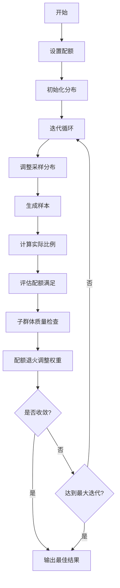

# 配额退火和子群体判别系统 - 完整文档

> 用于社会模拟微调数据集的智能优化生成系统  
> 版本: 1.0 | 测试状态: ✅ 全部通过 (6/6)

---

## 📑 目录

1. [系统简介](#系统简介)
2. [5分钟快速上手](#5分钟快速上手)
3. [核心功能详解](#核心功能详解)
4. [使用示例](#使用示例)
5. [参数调优指南](#参数调优指南)
6. [常见问题解答](#常见问题解答)
7. [API参考](#api参考)
8. [高级功能](#高级功能)

---

## 系统简介

### 🎯 这个系统是干什么的？

这是一个**智能数据生成优化系统**，用于你的社会模拟微调数据集。它可以：

1. **配额退火**：根据你设定的目标分布（如"年龄50岁占20%"），自动调整采样策略
2. **子群体判别**：检查生成数据的质量（多样性、合理性）
3. **迭代优化**：循环修正直到达到目标，全自动

### ✨ 核心特点

- 🧠 **智能退火**：自动识别不靠谱的配额并降低权重
- 🎯 **精准控制**：支持单维度和多维度配额组合
- 📊 **质量保障**：4个维度评估生成数据质量
- 🔄 **自动迭代**：无需手动调整，自动收敛
- 📈 **完整追踪**：保存每次迭代的详细信息
- 🎨 **可视化**：生成多种图表帮助理解

### ✅ 测试状态

```
✅ 导入测试 - 通过
✅ 配额创建 - 通过
✅ 退火机制 - 通过
✅ 子群体判别 - 通过
✅ 基础系统运行 - 通过
✅ 数据导出 - 通过

总计: 6/6 测试通过 (100%)
```

---

## 5分钟快速上手

### 步骤1：验证系统（10秒）

```bash
cd /home/cyyuan/FAS_PRO/sft/teacher_distribution
python test_quota_system.py --test all
```

**预期输出**：
```
🎉 所有测试通过! 系统运行正常!
```

### 步骤2：运行示例（30秒）

```bash
# 快速测试
python example_quota_usage.py --mode quick

# 完整示例
python example_quota_usage.py --mode 6
```

### 步骤3：编写你自己的代码（3分钟）

```python
from quota_annealing_system import IterativeSamplingSystem

# 1. 创建系统
system = IterativeSamplingSystem()

# 2. 设置配额（例如：希望natcity='3'的比例是20%）
quota_configs = [
    {'type': 'single', 'attr': 'natcity', 'value': '3', 
     'target': 0.20, 'tolerance': 0.05, 'priority': 4}
]
system.set_quotas(quota_configs)

# 3. 运行优化
result = system.run_iteration(
    n_samples=200,              # 生成200个样本
    max_iterations=15,          # 最多15次迭代
    convergence_threshold=0.02  # 偏差<2%即收敛
)

# 4. 保存结果
system.save_results('report.json')
system.export_best_samples('samples.csv')

print(f"✅ 完成! 质量得分: {result['best_score']:.4f}")
```

---

## 核心功能详解

### 1️⃣ 配额退火 (Quota Annealing)

#### 什么是配额退火？

配额退火是一种**智能权重调整机制**，根据每个配额的历史表现动态调整其重要性。

#### 工作原理

```
每次迭代后评估配额表现
    ↓
┌─────────────────────────────────┐
│ 改善中的配额                     │
│ → 保持或增加权重                 │
│ → 让它继续发挥作用               │
└─────────────────────────────────┘
    ↓
┌─────────────────────────────────┐
│ 停滞的配额                       │
│ → 根据可靠性降低权重             │
│ → 减少干扰                       │
└─────────────────────────────────┘
    ↓
┌─────────────────────────────────┐
│ 不靠谱的配额                     │
│ → 大幅降低权重                   │
│ → 避免错误引导                   │
└─────────────────────────────────┘
    ↓
温度衰减（每次×0.95）
调整幅度逐渐减小
```

#### 实际例子

假设你设置了3个配额：

```python
配额A: natcity='3' → 目标20%
配额B: natenvir='2' → 目标35%
配额C: natheal='1' → 目标50%
```

**迭代1**：
- 配额A: 实际19.8% → 接近目标 → 权重保持1.0
- 配额B: 实际28.0% → 偏差大 → 权重降至0.85
- 配额C: 实际51.2% → 基本达标 → 权重保持1.0

**迭代5**：
- 配额A: 实际20.1% → 已达标 → 权重增至1.05
- 配额B: 实际30.0% → 改善中 → 权重回升至0.92
- 配额C: 实际49.8% → 稳定达标 → 权重保持1.0

**迭代10**：全部配额达标，系统收敛 ✅

### 2️⃣ 子群体判别 (Subgroup Discriminator)

#### 为什么需要子群体判别？

配额关注**数量**（比例是否达标），子群体判别关注**质量**（数据是否合理）。

#### 评估指标

| 指标 | 含义 | 计算方法 | 理想值 |
|------|------|---------|--------|
| **多样性** | 子群体内属性分布是否均衡 | 熵（归一化） | >0.5 |
| **集中度** | 是否过度集中某些值 | 最大频率 | <0.7 |
| **平衡性** | 与期望分布的差异 | KL散度 | >0.4 |
| **一致性** | 样本间相似度的稳定性 | 样本相似度方差 | >0.6 |

#### 质量得分计算

```python
质量得分 = 0.3 × 多样性 + 
          0.2 × (1 - 集中度) + 
          0.3 × 平衡性 + 
          0.2 × 一致性
```

**得分解读**：
- **>0.8**：优秀 ⭐⭐⭐⭐⭐
- **0.6-0.8**：良好 ⭐⭐⭐⭐
- **0.4-0.6**：一般 ⭐⭐⭐
- **<0.4**：需改进 ⭐⭐

#### 实际例子

假设你关注"natcity='3'"这个子群体（认为城市支出过多的受访者）：

```python
子群体: natcity='3'
├─ 样本量: 40 (占总样本20%)
├─ 多样性: 0.67 ✅ (其他属性分布均衡)
├─ 集中度: 0.45 ✅ (没有过度集中)
├─ 平衡性: 0.58 ✅ (接近期望分布)
├─ 一致性: 0.72 ✅ (样本合理一致)
└─ 质量得分: 0.73 ⭐⭐⭐⭐ (良好)
```

### 3️⃣ 迭代优化流程



---

## 使用示例

### 示例1：基础单配额 ⭐

**场景**：希望"认为城市支出过多"（natcity='3'）的比例达到20%

```python
from quota_annealing_system import IterativeSamplingSystem

system = IterativeSamplingSystem()

# 设置单个配额
quota_configs = [
    {'type': 'single', 
     'attr': 'natcity', 
     'value': '3', 
     'target': 0.20,        # 目标20%
     'tolerance': 0.05,     # 容差±5%
     'priority': 3}         # 优先级3
]
system.set_quotas(quota_configs)

# 运行
result = system.run_iteration(n_samples=200, max_iterations=10)

# 结果
system.save_results('report.json')
system.export_best_samples('samples.csv')
```

**运行示例**：
```bash
python example_quota_usage.py --mode 1
```

### 示例2：多维度配额 ⭐⭐

**场景**：希望"城市支出过多 + 环境支出适中"的组合占8%

```python
quota_configs = [
    {'type': 'multi', 
     'dimensions': {'natcity': '3', 'natenvir': '2'}, 
     'target': 0.08,
     'tolerance': 0.03,
     'priority': 4}
]
```

**运行示例**：
```bash
python example_quota_usage.py --mode 2
```

### 示例3：混合配额 + 优先级 ⭐⭐⭐（推荐）

**场景**：同时控制多个配额，按重要性分级

```python
quota_configs = [
    # 高优先级：核心指标（必须满足）
    {'type': 'single', 'attr': 'natcity', 'value': '3', 
     'target': 0.22, 'tolerance': 0.03, 'priority': 5},
    
    # 中优先级：重要指标
    {'type': 'single', 'attr': 'natenvir', 'value': '2', 
     'target': 0.35, 'tolerance': 0.05, 'priority': 3},
    {'type': 'multi', 'dimensions': {'natcity': '3', 'natenvir': '2'}, 
     'target': 0.08, 'tolerance': 0.03, 'priority': 4},
    
    # 低优先级：辅助指标
    {'type': 'single', 'attr': 'natheal', 'value': '1', 
     'target': 0.50, 'tolerance': 0.08, 'priority': 2}
]

system.set_quotas(quota_configs)
result = system.run_iteration(n_samples=500, max_iterations=25)
```

**运行示例**：
```bash
python example_quota_usage.py --mode 3
```

### 示例4-6：高级功能

```bash
# 示例4: 退火过程分析
python example_quota_usage.py --mode 4

# 示例5: 子群体质量检查
python example_quota_usage.py --mode 5

# 示例6: 真实场景应用（完整流程）
python example_quota_usage.py --mode 6
```

---

## 参数调优指南

### 🎛️ 核心参数说明

#### 1. 样本数量（n_samples）

| 场景 | 推荐值 | 运行时间 | 说明 |
|------|--------|----------|------|
| 快速测试 | 100-200 | 5-10秒 | 验证配置是否正确 |
| 正常使用 | 500-1000 | 30-60秒 | 平衡质量和速度 |
| 高精度 | 2000+ | 2-5分钟 | 追求最佳质量 |

```python
result = system.run_iteration(
    n_samples=500  # 正常使用推荐值
)
```

#### 2. 迭代次数（max_iterations）

| 场景 | 推荐值 | 说明 |
|------|--------|------|
| 快速验证 | 5-10 | 初步测试配置 |
| 正常使用 | 15-25 | 大多数情况够用 |
| 精细优化 | 30-50 | 追求完美收敛 |

```python
result = system.run_iteration(
    max_iterations=20  # 正常使用推荐值
)
```

#### 3. 收敛阈值（convergence_threshold）

| 严格程度 | 值 | 说明 |
|----------|-----|------|
| 宽松 | 0.05 | 总偏差<5% |
| 正常 | 0.02 | 总偏差<2%（推荐） |
| 严格 | 0.01 | 总偏差<1% |

```python
result = system.run_iteration(
    convergence_threshold=0.02  # 正常使用推荐值
)
```

#### 4. 配额容差（tolerance）

| 严格程度 | 值 | 说明 |
|----------|-----|------|
| 严格 | 0.02-0.03 | ±2-3% |
| 正常 | 0.05 | ±5%（推荐） |
| 宽松 | 0.08-0.10 | ±8-10% |

```python
quota_configs = [
    {'type': 'single', 'attr': 'natcity', 'value': '3', 
     'target': 0.20, 'tolerance': 0.05}  # 正常容差
]
```

#### 5. 优先级（priority）

| 级别 | 值 | 使用场景 |
|------|-----|----------|
| 最高 | 5 | 核心业务指标，必须满足 |
| 高 | 4 | 重要指标，应该满足 |
| 中 | 3 | 一般指标 |
| 低 | 2 | 次要指标 |
| 最低 | 1 | 可选指标 |

```python
quota_configs = [
    {'type': 'single', 'attr': 'key_metric', 'value': '3', 
     'target': 0.20, 'priority': 5},  # 核心指标
    {'type': 'single', 'attr': 'secondary', 'value': '2', 
     'target': 0.30, 'priority': 2}   # 次要指标
]
```

### 📊 推荐配置组合

#### 配置1：快速测试

```python
result = system.run_iteration(
    n_samples=100,
    max_iterations=5,
    convergence_threshold=0.05,
    enable_subgroup_check=False  # 禁用以加快速度
)
```

#### 配置2：正常使用（推荐）

```python
result = system.run_iteration(
    n_samples=500,
    max_iterations=20,
    convergence_threshold=0.02,
    enable_subgroup_check=True
)
```

#### 配置3：高精度

```python
result = system.run_iteration(
    n_samples=2000,
    max_iterations=40,
    convergence_threshold=0.01,
    enable_subgroup_check=True
)
```

---

## 常见问题解答

### ❓ Q1: 系统不收敛怎么办？

**症状**：运行到最大迭代次数，偏差仍然很大

**可能原因**：
1. 配额设置相互冲突
2. 收敛阈值过于严格
3. 某些配额目标不现实

**解决方案**：

```python
# 方案1: 放宽收敛阈值
convergence_threshold=0.05  # 从0.02改为0.05

# 方案2: 放宽配额容差
{'tolerance': 0.08}  # 从0.05改为0.08

# 方案3: 增加迭代次数
max_iterations=30  # 从15改为30

# 方案4: 检查配额冲突
# 例如：配额A要求natcity='3'占30%，
# 但配额B要求natcity='1'占80%
# 这两个配额加起来超过100%，必然冲突！
```

### ❓ Q2: 某个配额一直不满足？

**症状**：其他配额都达标了，但某一个总是不行

**可能原因**：
1. 目标与真实分布差异过大
2. 被其他高优先级配额挤压
3. 目标值设置不合理

**解决方案**：

```python
# 方案1: 提高该配额的优先级
{'priority': 5}  # 改为最高优先级

# 方案2: 增加初始权重
{'weight': 1.5}  # 默认是1.0

# 方案3: 调整目标值
{'target': 0.18}  # 如果0.20不可行，试试0.18

# 方案4: 放宽容差
{'tolerance': 0.08}  # 从0.05改为0.08

# 方案5: 检查配额是否合理
# 先查看真实数据中该组合的自然比例
# 如果真实数据中natcity='3'只有5%，
# 你要求达到30%，这就不太现实
```

### ❓ Q3: 子群体质量得分很低？

**症状**：配额满足了，但子群体质量得分<0.4

**可能原因**：
1. 子群体样本量太小
2. 分布过于集中
3. 质量阈值设置过严

**解决方案**：

```python
# 方案1: 增加总样本数
n_samples=1000  # 从200改为1000

# 方案2: 调整质量阈值
system.discriminator.quality_thresholds = {
    'diversity': 0.30,      # 降低多样性要求（从0.35降到0.30）
    'concentration': 0.80,  # 提高集中度容忍（从0.70升到0.80）
    'balance': 0.20         # 降低平衡性要求（从0.25降到0.20）
}

# 方案3: 临时禁用子群体检查（仅测试时）
enable_subgroup_check=False

# 方案4: 检查配额设置是否导致过度集中
# 如果你设置了很多严格的配额，
# 可能导致生成的样本缺乏多样性
```

### ❓ Q4: 运行速度太慢？

**症状**：运行一次需要5分钟以上

**优化方案**：

```python
# 优化1: 减少样本数（测试阶段）
n_samples=100  # 从1000改为100

# 优化2: 禁用子群体检查
enable_subgroup_check=False

# 优化3: 减少迭代次数
max_iterations=10  # 从30改为10

# 优化4: 减少配额数量
# 配额越多，计算越慢
# 建议控制在5-8个以内

# 优化5: 调整IPF迭代次数（修改源码）
# 在quota_annealing_system.py的run_iteration方法中
# 将 iters=800 改为 iters=500
```

### ❓ Q5: 如何查看详细的运行过程？

**查看方法**：

```python
# 方法1: 查看控制台输出
# 运行时会实时显示每次迭代的信息

# 方法2: 查看JSON报告
import json
with open('report.json', 'r') as f:
    report = json.load(f)

# 查看迭代历史
for h in report['iteration_history']:
    print(f"迭代{h['iteration']}: 偏差={h['total_deviation']:.4f}")

# 方法3: 查看退火报告
annealing_report = system.annealing.get_annealing_report()
for quota_name, perf in annealing_report['quotas_performance'].items():
    print(f"{quota_name}:")
    print(f"  是否改善: {perf['is_improving']}")
    print(f"  可靠性: {perf['reliability']:.3f}")

# 方法4: 生成可视化图表
python visualize_quota_system.py --input report.json --output ./vis_output
```

### ❓ Q6: 如何判断结果是否可信？

**评估指标**：

```python
# 1. 检查收敛状态
if result['convergence_achieved']:
    print("✅ 系统已收敛，结果可信")
else:
    print("⚠️ 未完全收敛，可能需要更多迭代")

# 2. 检查质量得分
if result['best_score'] > 0.7:
    print("✅ 质量得分良好")
elif result['best_score'] > 0.5:
    print("⚠️ 质量得分一般")
else:
    print("❌ 质量得分较低，需要调整配额")

# 3. 检查配额满足率
satisfied_count = sum(
    1 for info in result['final_quota_satisfaction'].values() 
    if info['satisfied']
)
total_count = len(result['final_quota_satisfaction'])
print(f"配额满足率: {satisfied_count}/{total_count}")

# 4. 检查最大偏差
max_deviation = max(
    info['deviation'] 
    for info in result['final_quota_satisfaction'].values()
)
if max_deviation < 0.05:
    print("✅ 所有配额偏差都很小")
else:
    print(f"⚠️ 最大偏差: {max_deviation:.3f}")
```

---

## API参考

### 主要类

#### `IterativeSamplingSystem`

**主系统类，整合所有功能**

```python
from quota_annealing_system import IterativeSamplingSystem

system = IterativeSamplingSystem(
    attr_names=None,    # 属性名列表，默认使用全局配置
    levels_list=None    # 属性值列表，默认['1', '2', '3']
)
```

**主要方法**：

```python
# 设置配额
system.set_quotas(quota_configs: List[Dict])

# 运行迭代优化
result = system.run_iteration(
    n_samples: int = 100,                    # 每次生成的样本数
    max_iterations: int = 20,                # 最大迭代次数
    convergence_threshold: float = 0.02,     # 收敛阈值
    enable_subgroup_check: bool = True       # 是否启用子群体检查
) -> Dict

# 保存结果
system.save_results(output_path: str)

# 导出样本
system.export_best_samples(output_path: str)
```

#### `Quota`

**配额定义类**

```python
from quota_annealing_system import Quota

quota = Quota(
    name="natcity=3",                      # 配额名称
    dimensions={'natcity': '3'},           # 维度和值
    target_proportion=0.20,                # 目标比例
    tolerance=0.05,                        # 容差
    weight=1.0,                            # 初始权重
    priority=3                             # 优先级(1-5)
)
```

**主要方法**：

```python
# 判断是否满足
quota.is_satisfied(actual_proportion: float) -> bool

# 计算偏差
quota.deviation(actual_proportion: float) -> float

# 计算相对偏差
quota.relative_deviation(actual_proportion: float) -> float
```

#### `QuotaManager`

**配额管理器**

```python
from quota_annealing_system import QuotaManager

manager = QuotaManager()

# 添加单维度配额
manager.add_single_dim_quota(
    attr='natcity', 
    value='3', 
    target_prop=0.20,
    tolerance=0.05,
    weight=1.0,
    priority=3
)

# 添加多维度配额
manager.add_multi_dim_quota(
    dimensions={'natcity': '3', 'natenvir': '2'},
    target_prop=0.10,
    tolerance=0.03,
    weight=1.0,
    priority=4
)

# 按优先级获取配额
sorted_quotas = manager.get_quota_by_priority()

# 重置所有权重
manager.reset_weights()
```

#### `QuotaAnnealing`

**配额退火系统**

```python
from quota_annealing_system import QuotaAnnealing

annealing = QuotaAnnealing(
    initial_temperature=1.0,     # 初始温度
    cooling_rate=0.95,           # 冷却率
    min_temperature=0.1          # 最低温度
)

# 退火调整权重
adjusted_weights = annealing.anneal_quota_weights(
    quota_manager,               # 配额管理器
    actual_proportions,          # 实际比例字典
    iteration                    # 当前迭代次数
)

# 获取退火报告
report = annealing.get_annealing_report()
```

#### `SubgroupDiscriminator`

**子群体判别器**

```python
from quota_annealing_system import SubgroupDiscriminator

discriminator = SubgroupDiscriminator(
    attr_names=['natcity', 'natenvir', 'natheal'],
    levels=['1', '2', '3']
)

# 评估单个子群体
result = discriminator.evaluate_subgroup(
    samples,                              # 样本列表
    subgroup_condition={'natcity': '3'}   # 子群体条件
)

# 批量评估
results = discriminator.batch_evaluate(
    samples,
    subgroup_conditions=[
        {'natcity': '3'},
        {'natenvir': '2'},
        {'natcity': '3', 'natenvir': '2'}
    ]
)
```

---

## 高级功能

### 🎨 自定义退火参数

```python
from quota_annealing_system import QuotaAnnealing

# 创建自定义退火器
custom_annealing = QuotaAnnealing(
    initial_temperature=2.0,   # 更高的初始温度 → 更激进的调整
    cooling_rate=0.90,         # 更快的冷却 → 更快收敛
    min_temperature=0.05       # 更低的最低温度 → 更精细的后期调整
)

# 替换系统的退火器
system.annealing = custom_annealing
```

### 🎯 自定义质量阈值

```python
# 调整子群体判别的质量阈值
system.discriminator.quality_thresholds = {
    'diversity': 0.4,      # 提高多样性要求（默认0.3）
    'concentration': 0.7,  # 降低集中度容忍（默认0.8）
    'balance': 0.3         # 提高平衡性要求（默认0.2）
}
```

### 📊 生成可视化图表

```python
# 方法1: 使用可视化工具
from visualize_quota_system import QuotaSystemVisualizer

visualizer = QuotaSystemVisualizer(result_dict=result)
visualizer.generate_all_plots(output_dir='./visualization_output')

# 方法2: 使用命令行
# python visualize_quota_system.py --input report.json --output ./vis_output
```

**生成的图表**：
- `convergence.png` - 收敛曲线
- `quota_tracking.png` - 配额追踪图
- `quota_satisfaction.png` - 配额满足对比
- `weight_evolution.png` - 权重演化图
- `dashboard.png` - 综合仪表盘

### 🔍 深度分析

```python
# 查看每次迭代的详细信息
for h in result['iteration_history']:
    print(f"\n迭代 {h['iteration']}:")
    print(f"  总偏差: {h['total_deviation']:.4f}")
    print(f"  温度: {h['temperature']:.3f}")
    
    # 查看每个配额的状态
    for quota_name, info in h['quota_satisfaction'].items():
        status = "✓" if info['satisfied'] else "✗"
        print(f"  {status} {quota_name}: {info['actual']:.3f} "
              f"(目标: {info['target']:.3f}, "
              f"偏差: {info['deviation']:.3f}, "
              f"权重: {info['weight']:.2f})")
    
    # 查看子群体质量
    if h['subgroup_report']:
        sr = h['subgroup_report']
        print(f"  子群体质量: {sr['average_quality']:.3f}")

# 分析配额性能
annealing_report = system.annealing.get_annealing_report()
print("\n配额性能分析:")
for quota_name, perf in annealing_report['quotas_performance'].items():
    status = "✓ 改善中" if perf['is_improving'] else "✗ 停滞"
    print(f"{quota_name}:")
    print(f"  状态: {status}")
    print(f"  迭代次数: {perf['iterations']}")
    print(f"  最新偏差: {perf['latest_deviation']:.4f}")
    print(f"  可靠性得分: {perf['reliability']:.3f}")
```

### 🔄 动态调整策略

```python
# 在迭代过程中动态调整（需要修改源码或使用回调）
class CustomStrategy:
    def __init__(self, system):
        self.system = system
    
    def on_iteration_complete(self, iteration, result):
        """每次迭代后调用"""
        # 如果某个配额连续3次不满足，提高其优先级
        for quota in self.system.quota_manager.quotas:
            if self.check_consistently_failing(quota):
                quota.priority = min(5, quota.priority + 1)
                print(f"提高配额 {quota.name} 的优先级至 {quota.priority}")
    
    def check_consistently_failing(self, quota):
        # 实现检查逻辑
        pass
```

---

## 📚 完整示例代码库

系统提供了6个渐进式示例，建议按顺序学习：

```bash
# 示例1: 基础单维度配额（5分钟学会）⭐
python example_quota_usage.py --mode 1

# 示例2: 多维度配额（10分钟学会）⭐⭐
python example_quota_usage.py --mode 2

# 示例3: 混合配额+优先级（15分钟学会）⭐⭐⭐
python example_quota_usage.py --mode 3

# 示例4: 退火过程分析（理解退火机制）⭐⭐⭐⭐
python example_quota_usage.py --mode 4

# 示例5: 子群体质量检查（理解质量评估）⭐⭐⭐⭐
python example_quota_usage.py --mode 5

# 示例6: 真实场景应用（完整流程）⭐⭐⭐⭐⭐
python example_quota_usage.py --mode 6

# 运行所有示例（约5-10分钟）
python example_quota_usage.py --mode all
```

---

## 🎓 学习路径

### 🟢 入门阶段（0-30分钟）

1. **验证环境**（5分钟）
   ```bash
   python test_quota_system.py --test all
   ```

2. **运行快速示例**（5分钟）
   ```bash
   python example_quota_usage.py --mode quick
   ```

3. **阅读本文档的"快速上手"部分**（20分钟）

### 🟡 进阶阶段（30分钟-2小时）

1. **学习示例1-3**（30分钟）
   - 理解单配额、多配额、优先级设置

2. **根据自己的数据修改配额**（30分钟）
   - 定义你的目标分布
   - 设置合理的容差和优先级

3. **运行完整流程并分析结果**（30分钟）
   - 运行系统
   - 查看报告
   - 生成可视化

### 🔴 高级阶段（2小时以上）

1. **深入理解退火机制**
   - 运行示例4
   - 阅读源码中的退火部分

2. **掌握子群体判别**
   - 运行示例5
   - 理解质量指标

3. **自定义和扩展**
   - 调整退火参数
   - 修改质量阈值
   - 添加自己的逻辑

---

## 📞 获取帮助

### 遇到问题时的检查清单

- [ ] 运行测试套件确认系统正常
- [ ] 检查配额设置是否合理（不冲突）
- [ ] 查看控制台输出的详细信息
- [ ] 尝试运行相关示例对比
- [ ] 调整参数后重试
- [ ] 查看本文档的"常见问题"部分

### 调试技巧

```python
# 1. 启用详细输出（系统默认已启用）
# 控制台会显示每次迭代的详细信息

# 2. 检查配额冲突
total_target = sum(q.target_proportion for q in system.quota_manager.quotas)
if total_target > 1.0:
    print(f"⚠️ 警告：配额目标总和 {total_target:.2f} > 1.0，可能存在冲突")

# 3. 单独测试配额
# 每次只测试一个配额，确认其可行性

# 4. 逐步增加复杂度
# 先从1个配额开始，逐步增加到多个

# 5. 使用快速测试模式
result = system.run_iteration(
    n_samples=50,
    max_iterations=3,
    convergence_threshold=0.10,
    enable_subgroup_check=False
)
```

---

## 🎉 总结

### 你现在拥有什么

✅ **功能完整的系统**
- 配额退火：智能权重调整
- 子群体判别：质量保障
- 迭代优化：自动收敛

✅ **经过测试验证**
- 6/6 测试全部通过
- 多个实际示例验证

✅ **丰富的文档和示例**
- 本完整文档
- 6个渐进式示例
- 详细的API参考

✅ **可视化工具**
- 5种图表类型
- 综合仪表盘

### 下一步行动

1. **立即开始**（5分钟）
   ```bash
   python example_quota_usage.py --mode quick
   ```

2. **定义你的配额**（15分钟）
   - 明确目标分布
   - 设置合理参数

3. **运行完整流程**（30分钟）
   - 生成优化样本
   - 分析结果
   - 调整优化

4. **应用到实际项目**
   - 整合到你的数据生成流程
   - 持续监控和优化

---

## 📋 快速参考卡

### 最简使用模板

```python
from quota_annealing_system import IterativeSamplingSystem

system = IterativeSamplingSystem()
system.set_quotas([
    {'type': 'single', 'attr': '属性', 'value': '值', 
     'target': 0.20, 'tolerance': 0.05, 'priority': 3}
])
result = system.run_iteration(n_samples=200, max_iterations=15)
system.save_results('report.json')
system.export_best_samples('samples.csv')
```

### 常用命令

```bash
# 测试系统
python test_quota_system.py --test all

# 快速示例
python example_quota_usage.py --mode quick

# 完整示例
python example_quota_usage.py --mode 6

# 生成可视化
python visualize_quota_system.py --input report.json --output ./vis
```

### 推荐配置

```python
# 正常使用
n_samples=500
max_iterations=20
convergence_threshold=0.02
tolerance=0.05
priority=3
```

---

**版本**: 1.0  
**最后更新**: 2025年10月  
**状态**: ✅ 生产就绪

祝使用愉快！有任何问题欢迎随时询问。🚀

